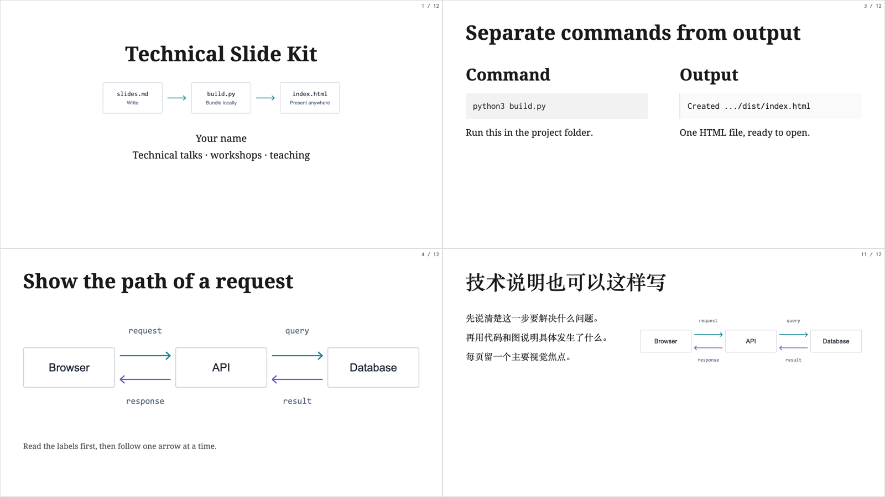

# Technical Slide Kit

A Markdown workshop template for technical talks, teaching, and illustrated explanations. Built with Python and [Remark.js](https://github.com/gnab/remark), extracted from a working course deck.

**[Live demo](https://sky-right.github.io/technical-slide-kit/)** · **[中文上手指南](docs/quickstart.zh-CN.md)** · [Writing slides](docs/authoring.md) · [Customizing the theme](docs/customization.md)



The theme keeps Droid Serif headings, Inconsolata code, a white page, generous margins, and small page numbers. It includes two-column layouts, command-and-diagram slides, SVG figures, presenter notes, and incremental reveals.

The builder produces **one HTML file**, including the runtime, fonts, styles, images, and license notices. Open it locally without a server or internet connection. The HTML build uses only the Python standard library.

## Start

Requires **Python 3.10+** and a current desktop browser.

```bash
git clone https://github.com/Sky-Right/technical-slide-kit.git
cd technical-slide-kit
python3 build.py
```

Open `dist/index.html`, or serve it:

```bash
python3 -m http.server 8000 --directory dist
```

Visit http://localhost:8000/. Windows users can run the same commands with `py` instead of `python3`.

For your own talk, use **Use this template** on GitHub or start a separate copy. Replace `content/slides.md`, or build the shorter starter:

```bash
python3 build.py content/starter.md --out dist/my-talk.html --title "My technical talk"
```

Edit the Markdown and run the build again. The output is generated; keep edits in the source files.

## Present

| Key | Action |
| --- | --- |
| Arrow keys / Space | Move through slides and reveals |
| P | Presenter view with notes |
| C | Open a cloned view for a second display |
| F | Full screen |
| ? | Keyboard help |

Presenter notes follow `???`. Reveal steps use `--`; a new slide uses `---`. Named slides can be linked as `index.html#diagram`.

Use your browser's **Print → Save as PDF**, with background graphics enabled. The print stylesheet includes each logical slide once, after its final reveal. The primary output is HTML; browser printing creates a PDF rather than an editable PowerPoint file.

## Project layout

```text
build.py                 Markdown + assets → portable HTML
content/slides.md        12-slide component demo
content/starter.md       A short starting point for your next talk
theme/slides.html        Remark setup and print handling
theme/slides.css         Workshop typography and layout helpers
theme/custom.css         Your theme overrides
theme/fonts/             Local fonts and their licenses
theme/vendor/            Pinned Remark runtime and its license
assets/                  Editable SVG examples; put your own images here
docs/                    Authoring and customization guides
tests/                   Standard-library builder checks
tools/check-browser.cjs  Optional browser and screenshot check
dist/                    Generated output, ignored by Git
```

Local images are relative to the Markdown file. Theme assets are relative to their stylesheet or template. Choose any output directory without rewriting those paths. For a custom corner Logo:

```bash
python3 build.py --logo assets/example-logo.svg
```

Replace that placeholder with your own asset. No institutional branding is included by default.

## Publish with GitHub Pages

In your template repository, open **Settings → Pages** and select **GitHub Actions** as the source. Push to `main`, or run **Build and publish demo** from Actions. The workflow tests the builder, builds the demo, and publishes only `dist/`.

Update the README demo URL for your account and repository. Before publishing, review the Markdown and presenter notes: notes are included in the HTML as well. Generated output contains the assets you reference, so keep private files outside the published project.

## Check a change

```bash
python3 -m unittest discover -s tests -v
python3 build.py
```

The tests cover local asset bundling, portable output paths, literal code examples, missing/remote assets, branding, and source preservation.

For the optional visual check, install Playwright separately:

```bash
npm install --no-save --package-lock=false playwright
npx playwright install chromium
node tools/check-browser.cjs
```

This checks the bundled demo offline, keyboard navigation, presenter mode, reveal states, printable pages, images, and three desktop sizes. It writes screenshots and a report to `dist/preview/`. `CHROME_BIN` selects an existing Chrome/Chromium executable; `PLAYWRIGHT_MODULE` can point to an installed Playwright package. The normal build does not need Node.js.

## License and origin

Maintained by Tianyou Yu ([Sky-Right](https://github.com/Sky-Right)). This kit's code, template, demo content, and diagrams use [Apache-2.0](LICENSE).

The theme follows the original [container.training](https://github.com/jpetazzo/container.training) workshop style and the refinements made in ct-slide-kit. Remark.js uses MIT; Inconsolata uses SIL OFL 1.1; Droid Serif uses Apache-2.0. See [NOTICE](NOTICE), [font provenance](theme/fonts/README.md), and [runtime provenance](theme/vendor/README.md). Retain those notices when redistributing. The single-file build embeds the relevant license texts.
