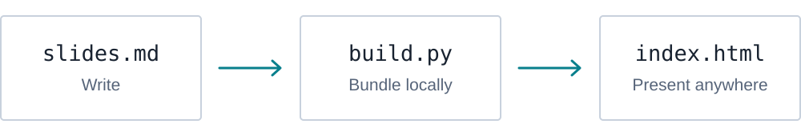
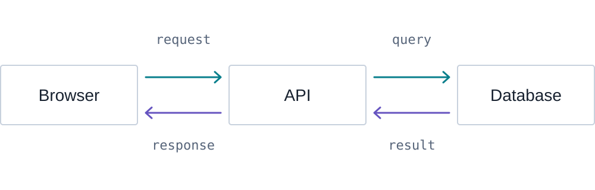

name: cover
class: cover

# Technical Slide Kit

.cover-figure[]

.subtitle[Your name]

.subtitle[Technical talks · workshops · teaching]

???

This demo uses the same workshop typography and layout as the extracted kit.
Use the arrow keys to navigate. Press P to see these notes and ? for help.

---
name: markdown
class: two-columns compact-code

# Write in Markdown

.left[
```markdown
# Explain one idea

- Start with a question.
- Show a concrete example.
- Leave room for the diagram.
```
]

.right[
## Explain one idea

- Start with a question.
- Show a concrete example.
- Leave room for the diagram.
]

???

The left column is source; the right is ordinary rendered Markdown. Separate
slides with three hyphens on their own line. Keep one main point per slide.

---
name: code
class: two-columns

# Separate commands from output

.left[
## Command

```bash
python3 build.py
```

Run this in the project folder.
]

.right[
## Output

.output[
```text
Created .../dist/index.html
```
]

One HTML file, ready to open.
]

???

Code is text, not a screenshot. Syntax highlighting is bundled with Remark.
Use the output class when the terminal is reporting a result.

---
name: diagram

# Show the path of a request

.figure[]

.caption[Read the labels first, then follow one arrow at a time.]

???

SVG stays sharp on a projector. These arrows show request and response
directions; they do not imply that the browser connects directly to the database.
The original SVG remains editable in assets/architecture.svg.

---
name: command-diagram
class: command

# Put the command beside the model

.left[
```bash
curl localhost:3000/api/items
```

The client sends a request.

The API reads the data and returns a response.
]

.right[

]

???

This example assumes an API listening on localhost:3000 with an /api/items
endpoint. Use the diagram to explain the request; the slide kit itself only
builds presentations. A browser and curl can both act as HTTP clients.

---
name: table

# Choose the right format

| Material | Good use |
| --- | --- |
| Markdown text | A short explanation or list |
| Code block | A command, program, or terminal result |
| SVG diagram | Relationships, states, and transitions |
| Cropped screenshot | A real interface and where to click |

???

Keep tables small enough to read from the back of the room. A screenshot should
show the relevant part of a real interface, not replace an explanatory diagram.

---
name: section
class: title inverse

# Reveal one step at a time

.subtitle[Give the audience time to think.]

???

The inverse class provides an occasional section divider. Regular content
keeps the original white workshop background.

---
name: reveal
class: quiz

# What does the finished deck need?

.question[An internet connection, or just the HTML file?]

--

.answer[Just the HTML file. Fonts, code, styles, and images are inside.]

???

Wait for an answer before pressing the next arrow. This is one logical slide
with two reveal states. Printing includes only the completed state.

---
name: exercise
class: lab

# Try the workflow

1. Edit a title in `content/slides.md`.
2. Run the build again.
3. Open the file, or serve the output folder.

```bash
python3 build.py
python3 -m http.server 8000 --directory dist
```

.note[Open http://localhost:8000/ after starting the server.]

???

Opening dist/index.html directly also works. HTTP serving is convenient for
sharing a local preview, but is not required for playback. Stop the server with
Control+C before reusing the terminal for another command.

---
name: theme
class: two-columns compact-code

# Keep the theme, change the details

.left[
```css
/* theme/custom.css */
:root {
  --accent: #087f8c;
}
```

Rebuild after changing the file.
]

.right[
Keep type sizes and spacing consistent.

Add your own Logo with `--logo` when needed.

Keep private files outside the published project.
]

???

The default theme keeps Droid Serif, Inconsolata, generous margins, and the
original top-right page numbers. Branding is optional rather than tied to an
institution. See docs/customization.md for the exact command.

---
name: chinese
class: command

# 技术说明也可以这样写

.left[
先说清楚这一步要解决什么问题。

再用代码和图说明具体发生了什么。

每页留一个主要视觉焦点。
]

.right[

]

???

中文正文使用系统中可用的中文衬线字体。英文和代码字体已打包。需要跨平台完全相同的中文字形时，可以自行加入有适当许可的本地字体并配置 @font-face。

---
name: closing
class: closing

# Thank you

.subtitle[Your name]

???

Replace this with the information your audience needs. The source and output
belong to the talk you create; the kit does not insert tracking or hosted assets.
